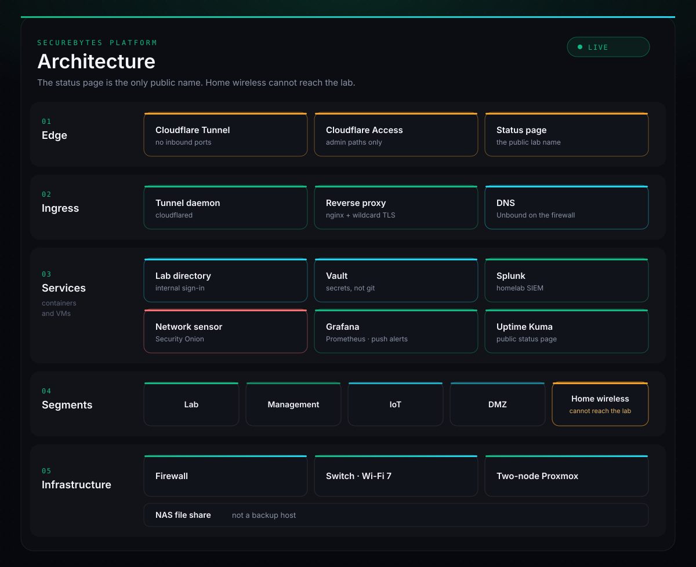

# SecureBytes Platform

A self-hosted platform for network and security infrastructure.

---

---

## Overview

Internal services run as LXC containers and VMs on a two-node Proxmox cluster. nginx terminates a wildcard certificate. The firewall is the DNS authority. The only lab name on the public internet is the status page, reached by a Cloudflare Tunnel with no inbound ports. Home wireless is its own segment and cannot reach the lab. Solid boxes in the diagram are live. A dashed box is a later decision, not a commitment.

## Current Footprint

<table>
<thead>
<tr>
<th align="left">Layer</th>
<th align="left">Live</th>
<th align="left">Later</th>
</tr>
</thead>
<tbody>
<tr>
<td><b>Edge</b></td>
<td>Cloudflare Tunnel · Cloudflare Access · public status page</td>
<td>—</td>
</tr>
<tr>
<td><b>Ingress</b></td>
<td>cloudflared · nginx + wildcard TLS · Unbound on the firewall</td>
<td>—</td>
</tr>
<tr>
<td><b>Identity</b></td>
<td>Lab directory for internal sign-in. Switch 802.1X stays off.</td>
<td>—</td>
</tr>
<tr>
<td><b>Platform</b></td>
<td>Vault · directory · reverse proxy · SIEM · network sensor</td>
<td>k3s only after an explicit decision</td>
</tr>
<tr>
<td><b>Observability</b></td>
<td>Grafana · Prometheus · Uptime Kuma · Splunk · Security Onion</td>
<td>—</td>
</tr>
<tr>
<td><b>Segments</b></td>
<td>Lab · management · IoT · DMZ · home wireless</td>
<td>Home wireless stays off the lab</td>
</tr>
<tr>
<td><b>Infrastructure</b></td>
<td>Two-node Proxmox · firewall · switch · Wi-Fi 7 AP · NAS file share</td>
<td>The NAS is not a backup host</td>
</tr>
</tbody>
</table>

Cisco modeling stays powered off unless there is a lab window. It is not part of the always-on platform.

## Live Status

[**status.securebytes.net/status/lab →**](https://status.securebytes.net/status/lab)

[**Project write-up on securebytes.net →**](https://securebytes.net/projects/securebytes-platform/)

